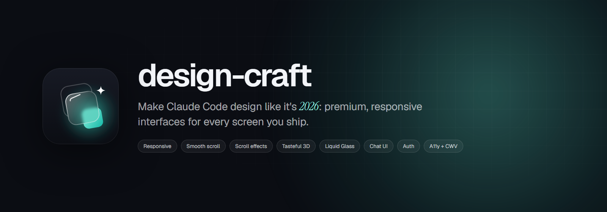
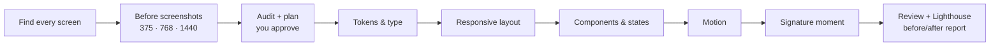

<p align="center">
  
</p>

<p align="center">
  <a href="LICENSE"></a>
  
  
  
</p>

<p align="center">
  <b>One skill that makes Claude Code design premium, responsive, 2026-level interfaces for every screen you build.</b><br>
  Landing pages, chat windows, login and signup, forms, dashboards and docs: audited, planned, built in passes and checked with screenshots.
</p>

---

## Why

Ask an AI to "make it look good" and you get the same page every time: purple gradients, three identical cards, Inter, a hero that only works on desktop. Design skills fix parts of this, but you end up juggling five of them, and some push a style you may not want (flat, empty "minimal" pages).

**design-craft** is the conductor. It knows what a modern interface looks like in 2026, holds *your* taste in one file, applies the right rules to each kind of screen, and calls the best specialist skills at the right moment, installing them if they are missing.

## Quick start

In Claude Code:

```text
/plugin marketplace add Ahsuu27488/design-craft
/plugin install design-craft@design-craft
```

Restart Claude Code, open any project and say:

```text
use design-craft and polish this UI/UX
```

On first use it installs its companion skills user-wide (needs Node 20+; on Windows, Git Bash). That's it.

<details>
<summary>Prefer the terminal?</summary>

```bash
claude plugin marketplace add Ahsuu27488/design-craft
claude plugin install design-craft@design-craft --scope user
bash ~/.claude/plugins/marketplaces/design-craft/scripts/setup.sh   # optional: install companions now
```
</details>

## What it does



Every kind of screen gets its own rules, not one landing-page recipe for everything:

| Surface | What you get |
|---|---|
| **Landing / marketing** | Smooth scroll (Lenis), text reveals, one scroll story, glass nav, one signature 3D or shader moment, real proof |
| **Chat window** | Opens from its launcher, full-screen sheet on phones, streaming with stop, typing indicator, source chips, retry on errors, `aria-live` |
| **Login / signup** | Visible labels, right `autocomplete`, inline errors, show/hide password, loading states, social buttons that match |
| **Buttons & controls** | One system: variants, sizes, hover, focus-visible, press, disabled, loading |
| **App / dashboard** | Skeletons, optimistic UI, view transitions, responsive tables and sidebars, no gimmicks |
| **Docs / textbook** | Reading-first type, TOC with scroll-spy, progress bar, theme-token restyling (Docusaurus, Nextra, Starlight) |

**Responsive is mandatory on every surface**: tested at 320 to 1920 px, layouts reflow instead of shrinking, 44 px touch targets, `dvh` and safe areas, and heavy effects scale down on phones.

## The skill stack it conducts

| Need | Companion | Installed |
|---|---|---|
| Direction, typography, avoiding AI tells | [`frontend-design`](https://github.com/anthropics/claude-plugins-official) (Anthropic) | on setup |
| Palettes, font pairings, UX rule lookup | [`ui-ux-pro-max`](https://github.com/nextlevelbuilder/ui-ux-pro-max-skill) | on setup |
| UI motion and polish | [`emil-design-eng`](https://github.com/emilkowalski/skills) | on setup |
| Springs, gestures, sheets, materials | [`apple-design`](https://github.com/emilkowalski/skills) | on setup |
| Review with `file:line` findings | [`web-design-guidelines`](https://github.com/vercel-labs/agent-skills) (Vercel) | on setup |
| Audit, critique, polish | [`impeccable`](https://github.com/pbakaus/impeccable) | on setup |
| Pinned scroll, ScrollTrigger, SplitText | [GSAP skills](https://github.com/greensock/gsap-skills) | when needed |
| 3D, R3F, shaders | [Three.js skills](https://github.com/CloudAI-X/threejs-skills) | when needed |
| Janky animations, leaks | [`optimize-web-animations`](https://github.com/MengTo/Skills) | when needed |
| Ready components | [21st.dev plugin](https://github.com/21st-dev/claude-code-plugin) | when needed |

design-craft brings its own technique references on top: Lenis + GSAP sync, CSS scroll-driven animations, View Transitions, Apple Liquid Glass on the web (with the Chromium-only refraction caveat), WebGPU/TSL notes, Core Web Vitals budgets and copy-paste recipes. Every claim is sourced in [`references/research-2026-10.md`](skills/design-craft/references/research-2026-10.md).

## Make it yours

The taste lives in one file: [`skills/design-craft/taste-profile.md`](skills/design-craft/taste-profile.md). It ships with the author's taste (premium, smooth, depth, Liquid Glass on the floating layer; no flat solid-colour minimalism). Fork the repo and edit it, or tell Claude:

```text
add to my design-craft taste profile: I prefer light themes and serif headlines
```

The project's own brief and brand always win over the profile.

## What's inside

```text
.claude-plugin/              plugin + marketplace manifests
skills/design-craft/
├── SKILL.md                 workflow, skill map, rules, pre-ship checklist
├── taste-profile.md         likes and dislikes (edit me)
├── surfaces.md              rules per screen type + mandatory responsive rules
├── companions.md            companion skills, when to use, install commands
└── references/
    ├── craft.md             techniques, defaults, budgets, which library for which effect
    ├── recipes.md           copy-paste code (Lenis, GSAP, glass, R3F, view transitions…)
    └── research-2026-10.md  the research behind it, with sources
scripts/setup.sh             installs core companions, safe to re-run
```

## FAQ

**Does it work outside web projects?** It is built for web UI (any stack: Next.js, React, Vue, Svelte, Astro, plain HTML, Docusaurus). The principles help native apps, but recipes are web-first.

**Will it redesign my brand?** No. It reads your existing tokens, DESIGN.md and brief first; refinement keeps your identity. It shows a plan before large changes.

**Why not just install all the design skills?** They overlap and sometimes contradict each other. design-craft decides who handles what, in which order, and which wins.

**Does it need API keys?** No. Optional tools like the 21st.dev plugin use your own account key from an environment variable, never from files.

## Contributing

Issues and PRs are welcome: new recipes, better surface rules, fixes to companion install commands. See [CONTRIBUTING.md](CONTRIBUTING.md).

## License

[MIT](LICENSE) © Muhammad Ahsan. Companion skills belong to their authors under their own licenses; design-craft only links to and installs them.
